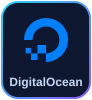
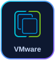
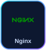
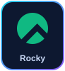
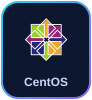
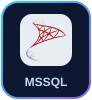
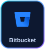

  

  

  
  
  
  

 

## ⚡ What I do for clients

I help startups, enterprises and governments run production without drama — **5+ years in DevOps, 9+ years in IT**.
Right now I run **HIPAA-regulated telehealth infrastructure for a US company**; before that I scaled AWS for **Dell, Ford and Nestlé** (VML / WPP) and kept Bangladesh’s **national railway ticketing at 99.99% uptime** under **500K+ concurrent users per hour**.

  

| 🚀 Service | ✅ What you get |
|---|---|
|  | Secure, cost-aware setups on AWS, Azure, GCP or DigitalOcean |
|  | Build → test → deploy automation with Jenkins, GitHub Actions, GitLab CI, Azure Pipelines |
|  | Docker, Kubernetes and ECS that scale with your traffic |
|  | Repeatable, audit-friendly infrastructure with Terraform and Ansible |
|  | Prometheus, Grafana, Zabbix and Kibana — catch issues before users do |
|  | HIPAA-ready infra, VPN access control, patching, backup and disaster recovery |
|  | AI-assisted reviews, faster troubleshooting, AI apps deployed to production |

## 🖥️ A day in production

  

## 📈 Impact

  

## 🛠️ Tech stack

<h4 align="center">☁️ Cloud and containers</h4>

  
  
  
  
  
  
  

<h4 align="center">⚙️ IaC, CI/CD and scripting</h4>

  
  
  
  
  
  
  
  

<h4 align="center">📊 Monitoring and web</h4>

  
  
  
  

<h4 align="center">🐧 OS and databases</h4>

  
  
  
  
  
  
  
  

<h4 align="center">🔀 Version control</h4>

  
  
  

> Also hands-on with Amazon ECS, Zabbix, Nagios, Azure Pipelines, Cisco and MikroTik networking.

## 🧭 Experience

<table>
<tr><th></th><th align="left">Company</th><th align="left">Role</th><th align="left">Period</th></tr>
<tr>
<td align="center"></td>
<td><a href="https://redlimesolutions.com/"><b>RedLime Solutions</b></a> US company · HIPAA healthcare and telehealth</td>
<td><b>DevOps Engineer</b> </td>
<td></td>
</tr>
<tr>
<td align="center"></td>
<td><a href="https://www.vml.com/"><b>VML (fka Wunderman Thompson)</b></a> WPP Group · Dell, Ford, Nestlé</td>
<td><b>DevOps Engineer</b> </td>
<td></td>
</tr>
<tr>
<td align="center"></td>
<td><a href="https://www.shohoz.com/"><b>Shohoz · BD Rail</b></a> National train ticketing (Govt.)</td>
<td><b>DevOps Engineer</b> </td>
<td></td>
</tr>
<tr>
<td align="center"></td>
<td><a href="https://ibos.io/"><b>iBOS Limited</b></a> An Akij Group company</td>
<td><b>DevOps Engineer (promoted)</b> </td>
<td></td>
</tr>
<tr>
<td align="center"></td>
<td><a href="https://www.akij.net/"><b>Akij Group</b></a> Infrastructure and networking</td>
<td><b>System Support Engineer</b> </td>
<td></td>
</tr>
<tr>
<td align="center"></td>
<td><a href="https://chardike.com/"><b>Chardike</b></a> Project-based engagement</td>
<td><b>DevOps and Cloud Engineer</b> </td>
<td></td>
</tr>
<tr>
<td align="center"></td>
<td><a href="https://ibitltd.com/"><b>iBIT Ltd</b></a> Project-based engagement</td>
<td><b>DevOps and Cloud Engineer</b> </td>
<td></td>
</tr>
<tr>
<td align="center"></td>
<td><a href="https://igenhr.com/"><b>iGen HR</b></a> Project-based engagement</td>
<td><b>DevOps and Cloud Engineer</b> </td>
<td></td>
</tr>
<tr>
<td align="center"></td>
<td><a href="https://blastify.ai/"><b>Blastify</b></a> Project-based engagement</td>
<td><b>DevOps and Cloud Engineer</b> </td>
<td></td>
</tr>
<tr>
<td align="center"></td>
<td><a href="https://finclarity.io/"><b>FinClarity</b></a> Project-based engagement</td>
<td><b>DevOps and Cloud Engineer</b> </td>
<td></td>
</tr>
<tr>
<td align="center"></td>
<td><a href="https://thesailpilot.com/"><b>The Sail Pilot</b></a> Project-based engagement</td>
<td><b>DevOps and Cloud Engineer</b> </td>
<td></td>
</tr>
</table>

## 🤝 Contract and project work

Project-based engagements delivered alongside my full-time roles.

  
  
  

  
  
  

## 🎓 Certifications

    

   

## 📊 GitHub activity

  
  

  

  

  
  
  
  

