

  

  
  
  
  

  <b>DevOps Engineer · 5+ yrs DevOps · 9+ yrs IT</b> — HIPAA telehealth infra (US) · AWS for Dell, Ford and Nestlé (WPP) · 99.99% uptime at 500K+ users/hour (BD Rail)

  <a href="https://aws.amazon.com">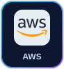</a>
  <a href="https://azure.microsoft.com">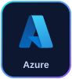</a>
  
  <a href="https://www.docker.com">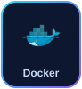</a>
  <a href="https://kubernetes.io">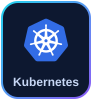</a>
  <a href="https://www.terraform.io">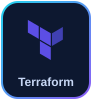</a>
  <a href="https://www.ansible.com">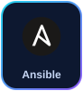</a>
  <a href="https://www.jenkins.io">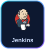</a>
  <a href="https://github.com/features/actions">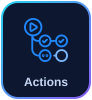</a>
  <a href="https://about.gitlab.com">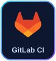</a>
  <a href="https://www.python.org">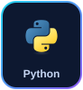</a>
  <a href="https://www.gnu.org/software/bash/">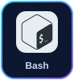</a>
  
  
  <a href="https://www.elastic.co/kibana">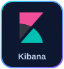</a>
  
  <a href="https://ubuntu.com">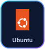</a>
  <a href="https://www.mysql.com">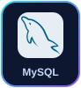</a>
  <a href="https://www.postgresql.org">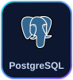</a>
  <a href="https://www.mongodb.com">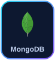</a>
  <a href="https://git-scm.com">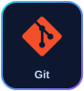</a>
  

<b>💼 Services for clients</b>

 

| 🚀 Service | ✅ What you get |
|---|---|
|  | Secure, cost-aware setups on AWS, Azure, GCP or DigitalOcean |
|  | Build → test → deploy automation with Jenkins, GitHub Actions, GitLab CI, Azure Pipelines |
|  | Docker, Kubernetes and ECS that scale with your traffic |
|  | Repeatable, audit-friendly infrastructure with Terraform and Ansible |
|  | Prometheus, Grafana, Zabbix and Kibana — catch issues before users do |
|  | HIPAA-ready infra, VPN access control, patching, backup and disaster recovery |
|  | AI-assisted reviews, faster troubleshooting, AI apps deployed to production |

<b>🧭 Experience — RedLime · VML/WPP · Shohoz · iBOS · Akij</b>

 

<table>
<tr><th></th><th align="left">Company</th><th align="left">Role</th><th align="left">Period</th></tr>
<tr>
<td align="center"></td>
<td><a href="https://redlimesolutions.com/"><b>RedLime Solutions</b></a> US company · HIPAA healthcare and telehealth</td>
<td><b>DevOps Engineer</b> </td>
<td></td>
</tr>
<tr>
<td align="center"></td>
<td><a href="https://www.vml.com/"><b>VML (fka Wunderman Thompson)</b></a> WPP Group · Dell, Ford, Nestlé</td>
<td><b>DevOps Engineer</b> </td>
<td></td>
</tr>
<tr>
<td align="center"></td>
<td><a href="https://www.shohoz.com/"><b>Shohoz · BD Rail</b></a> National train ticketing (Govt.)</td>
<td><b>DevOps Engineer</b> </td>
<td></td>
</tr>
<tr>
<td align="center"></td>
<td><a href="https://ibos.io/"><b>iBOS Limited</b></a> An Akij Group company</td>
<td><b>DevOps Engineer (promoted)</b> </td>
<td></td>
</tr>
<tr>
<td align="center"></td>
<td><a href="https://www.akij.net/"><b>Akij Group</b></a> Infrastructure and networking</td>
<td><b>System Support Engineer</b> </td>
<td></td>
</tr>
<tr>
<td align="center"></td>
<td><a href="https://chardike.com/"><b>Chardike</b></a> Project-based engagement</td>
<td><b>DevOps and Cloud Engineer</b> </td>
<td></td>
</tr>
<tr>
<td align="center"></td>
<td><a href="https://ibitltd.com/"><b>iBIT Ltd</b></a> Project-based engagement</td>
<td><b>DevOps and Cloud Engineer</b> </td>
<td></td>
</tr>
<tr>
<td align="center"></td>
<td><a href="https://igenhr.com/"><b>iGen HR</b></a> Project-based engagement</td>
<td><b>DevOps and Cloud Engineer</b> </td>
<td></td>
</tr>
<tr>
<td align="center"></td>
<td><a href="https://blastify.ai/"><b>Blastify</b></a> Project-based engagement</td>
<td><b>DevOps and Cloud Engineer</b> </td>
<td></td>
</tr>
<tr>
<td align="center"></td>
<td><a href="https://finclarity.io/"><b>FinClarity</b></a> Project-based engagement</td>
<td><b>DevOps and Cloud Engineer</b> </td>
<td></td>
</tr>
<tr>
<td align="center"></td>
<td><a href="https://thesailpilot.com/"><b>The Sail Pilot</b></a> Project-based engagement</td>
<td><b>DevOps and Cloud Engineer</b> </td>
<td></td>
</tr>
</table>

<b>🤝 Contract projects — Chardike · iBIT · iGen HR · Blastify · FinClarity · The Sail Pilot</b>

 

  <a href="https://chardike.com/">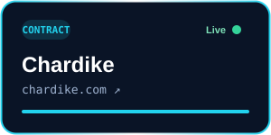</a>
  <a href="https://ibitltd.com/">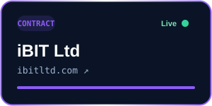</a>
  <a href="https://igenhr.com/">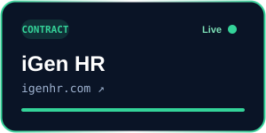</a>

  <a href="https://blastify.ai/">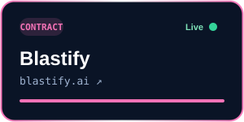</a>
  <a href="https://finclarity.io/">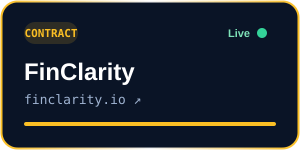</a>
  <a href="https://thesailpilot.com/">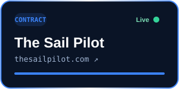</a>

<b>🚀 How I ship and impact</b>

 




<b>🎓 Certifications</b>

 

    

   

